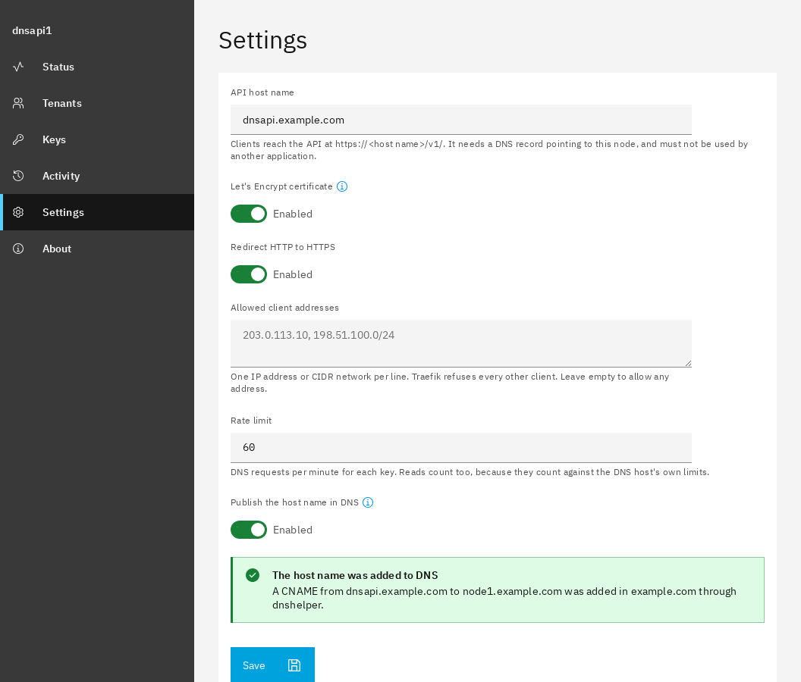
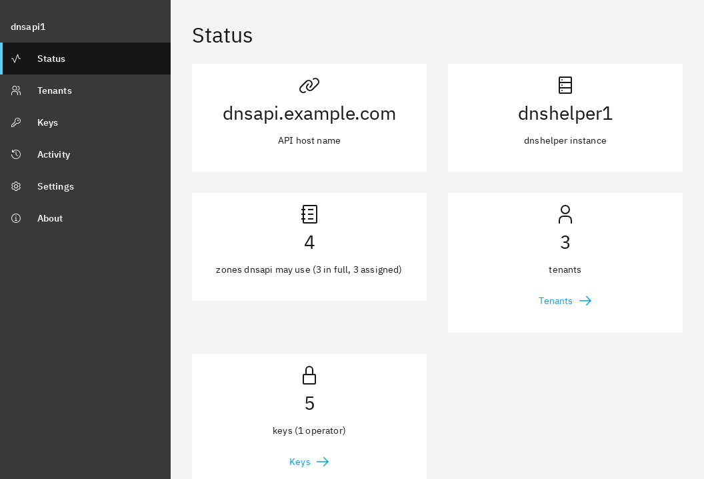
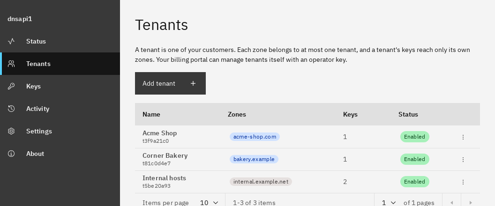
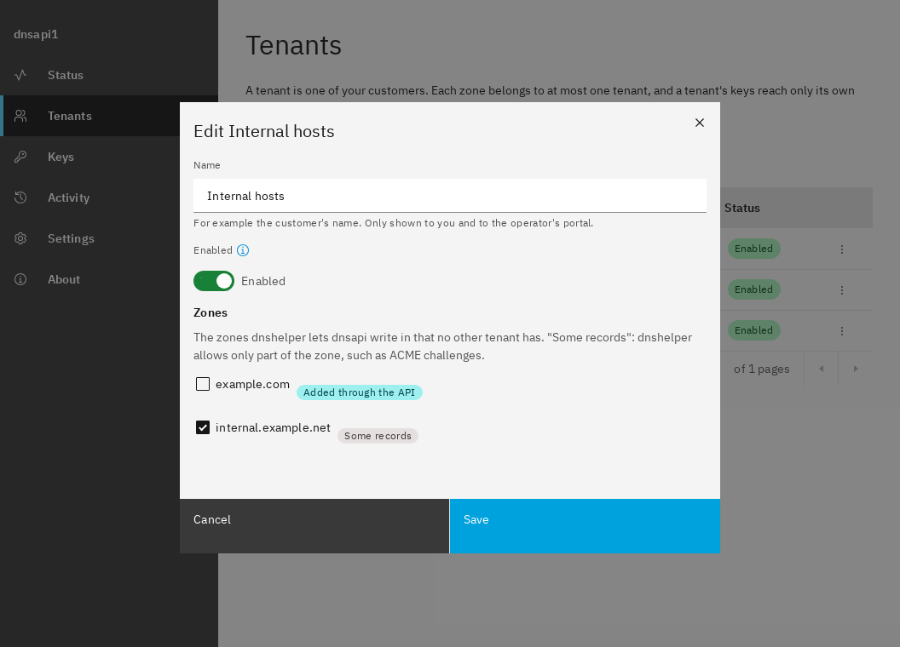
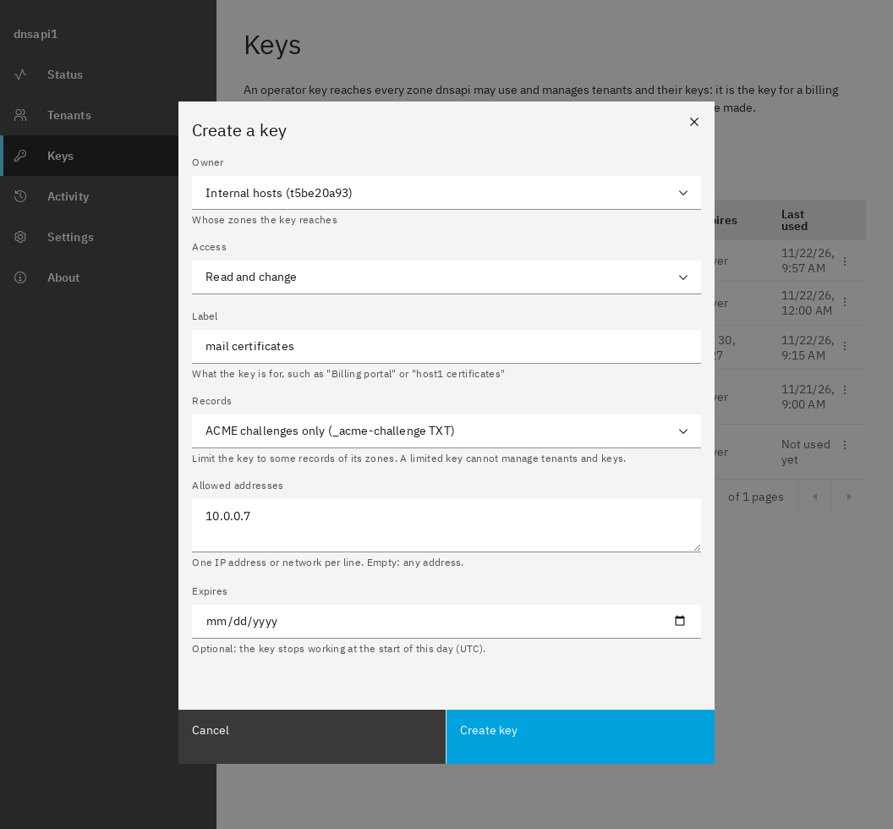
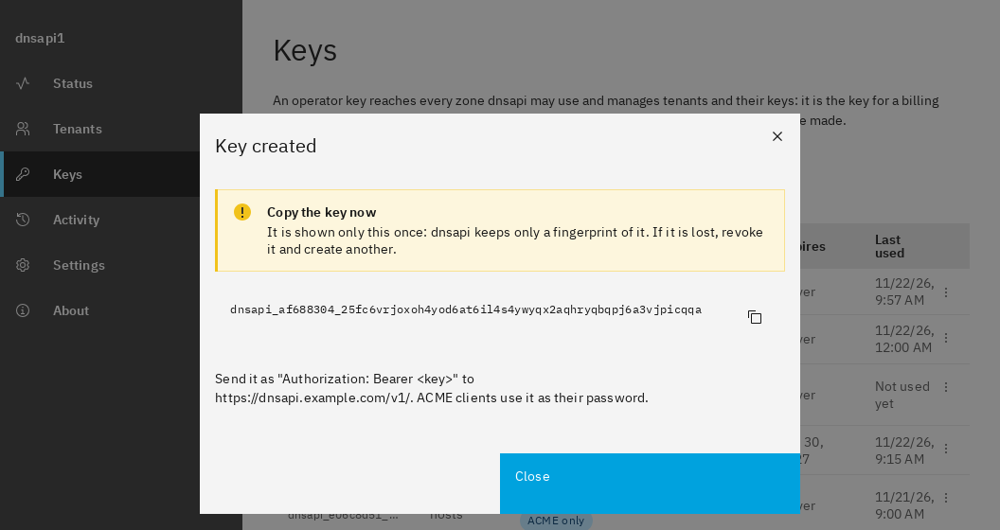
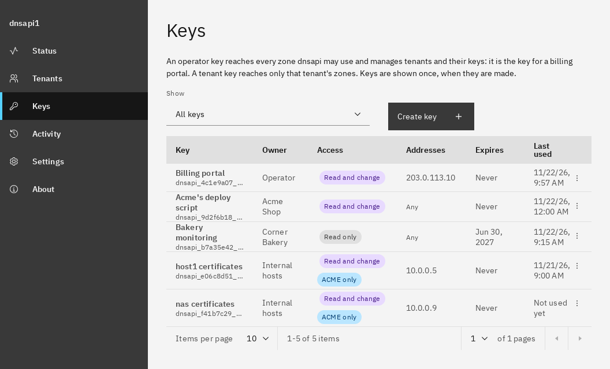
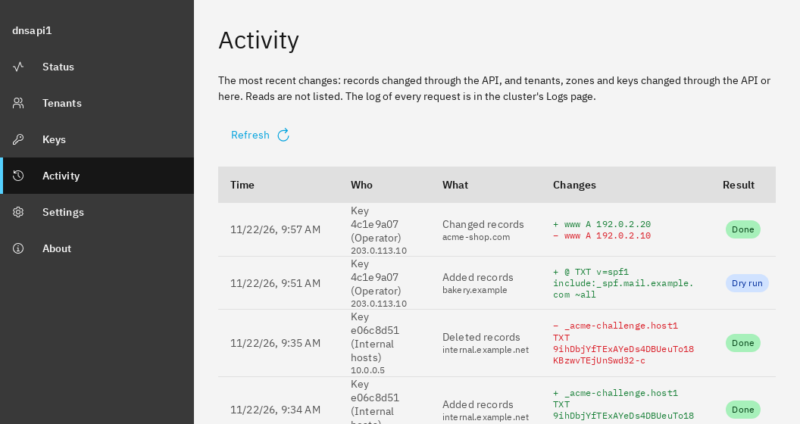

# dnsapi user guide

This guide is for the person who administers an NS8 node. It explains what dnsapi does, what it
needs before it can do anything, how to publish the API, how to decide which zones it may hand
out, how to make keys for a billing portal, for customers and for systems that need
certificates, and what to do when something goes wrong. Developers who write a client for the
API, or who want to know how dnsapi is built, should read the [main README](../README.md)
instead. What data dnsapi keeps, and where it sends it, is in [TERMS.md](../TERMS.md).

Everything here can be done from the module's pages in the cluster admin UI (Status, Tenants,
Keys, Activity, Settings). The command-line equivalent (`api-cli`, `runagent` on the node) follows
each step, for scripts.

- [What dnsapi does](#what-dnsapi-does)
- [Before you start](#before-you-start)
- [Publishing the API](#publishing-the-api)
- [Letting dnsapi use zones](#letting-dnsapi-use-zones)
- [Tenants and their zones](#tenants-and-their-zones)
- [Keys](#keys)
- [Connecting a billing or client portal](#connecting-a-billing-or-client-portal)
- [Certificates for other systems (ACME DNS-01)](#certificates-for-other-systems-acme-dns-01)
- [Seeing what happened](#seeing-what-happened)
- [Backup and restore](#backup-and-restore)
- [When something goes wrong](#when-something-goes-wrong)

## What dnsapi does

dnsapi publishes an HTTPS API on a host name of its own, so that software outside the cluster
can read and change DNS records:

- a billing or client portal (Blesta, WHMCS, your own) that manages your customers' DNS;
- your customers' own scripts, each limited to that customer's zones;
- systems that get certificates from Let's Encrypt with the DNS-01 challenge, including ones the
  internet cannot reach, each limited to its `_acme-challenge` records.

It does not talk to DNS hosts itself. Every read and change goes through
[dnshelper](https://github.com/danb35/ns8-dnshelper), which holds the DNS host credentials and
decides, on its Access page, what dnsapi may touch. dnsapi adds its own limits on top: which
customer (tenant) owns which zone, and what each key may do.

## Before you start

- **dnshelper 0.7.0 or later**, with the zones you want to manage added to it. Older releases do
  not tell dnsapi how much it may change, and dnsapi then offers no zones.
- **A host name for the API**, such as `dnsapi.example.com`, with a DNS record pointing to the
  node; when the name is in a zone dnshelper manages, dnsapi can add the record itself (see
  [below](#publishing-the-api)). It must not be used by another application on the node.
- To get a Let's Encrypt certificate for that name, port 80 of the node must be reachable from
  the internet.

## Publishing the API

On the **Settings** page, set the host name, and optionally the certificate, the addresses
allowed to connect and the rate limit.

From the command line:

    api-cli run module/dnsapi1/configure-module --data '{"host": "dnsapi.example.com", "lets_encrypt": true}'

- `host`: the API is served at `https://<host>/v1/`. Required the first time.
- `lets_encrypt`: request a Let's Encrypt certificate. If it is not issued, the action fails and
  nothing changes. Default off.
- `ip_allowlist`: addresses or networks (`203.0.113.10`, `198.51.100.0/24`) that may reach the
  API at all; everyone else is refused before dnsapi sees the request. Empty allows every
  address. If your only client is a billing server, put its address here.
- `rate_limit`: DNS requests per minute for each key, default 60. Reads count too, because they
  count against your DNS host's own limits (GoDaddy, for example, allows about 60 per minute).
- `revoke_cleartext_keys` (**Revoke keys sent over plain HTTP**): the API refuses plain HTTP;
  with this on, a valid key a client sends over it, operator keys included, is also revoked at
  once. Default on. See [Keys sent over plain HTTP](#keys-sent-over-plain-http).

The API is not redirected from HTTP to HTTPS: a plain-HTTP request reaches dnsapi, which refuses
it with `403 https_required`. (Earlier versions had a "Redirect HTTP to HTTPS" setting; updating
removes the redirect.)

On the command line, a field you leave out keeps its value. The **Status** page then shows the
API's address. Check that it answers:

    curl https://dnsapi.example.com/v1/status

which answers `{"status": "ok"}`.

**The host name's DNS record.** When the host name is in a zone dnshelper manages, dnsapi adds
the record itself, before requesting the certificate: a CNAME from the host name to this node's
own host name. It needs a rule on dnshelper's Access page for `module/dnsapi1`: write, names the
host name relative to the zone (`dnsapi` for `dnsapi.example.com`), type `CNAME`. The "API module
(all records)" preset on the zone covers it too. Settings shows what dnsapi found:

- the CNAME is there, or was just added (dnsapi then waits up to a minute and a half for the
  zone's name servers to answer with it, so that Let's Encrypt can see it);
- another record is at the name: dnsapi never changes it; point it to this node on dnshelper's
  Records page, or turn off "Publish the host name in DNS";
- the zone is not in dnshelper, there is no rule, or the host name is a zone's apex (which
  cannot have a CNAME): add the record yourself at your DNS host.

None of these stops the settings from being saved. If you change the host name, the old name's
record stays; remove it on dnshelper's Records page, where it is listed as dnsapi's.

No API key can change the records of the API's own host name, or of `_acme-challenge` at that
name, even when its zone belongs to a tenant: a customer could otherwise point the API elsewhere
and collect the keys sent to it (`403 reserved_name`).

## Letting dnsapi use zones

dnshelper refuses everything to dnsapi until you add a rule for it. On dnshelper's Access page,
add a rule for `module/dnsapi1` on the zones it may hand out, with one of two presets:

- **API module (all records)**: dnsapi may change every record of the zone. Use it for a
  customer who manages the whole zone through your portal.
- **ACME DNS-01**: dnsapi may change only `_acme-challenge` TXT records. Use it for a zone that is
  used only to validate certificates (see [below](#certificates-for-other-systems-acme-dns-01)).

dnshelper still refuses what no rule covers, and never changes the zone's SOA or its apex NS
records. The **Status** page counts the zones dnsapi may use, and says so when there are none; on
the **Tenants** page, a zone marked "Some records" is one where dnsapi may change only what the
rule allows. From the command line:

    api-cli run module/dnsapi1/list-assignable-zones

## Tenants and their zones

A tenant is one of your customers. Each zone belongs to at most one tenant, and a tenant's keys
reach only its own zones.

On the **Tenants** page, **Add tenant** asks for a name and the zones to give it: the zones dnsapi
may use that no other tenant has. **Edit** renames a tenant, gives or takes zones, and disables
it: a disabled tenant's keys are refused until you enable it again. **Remove** removes a tenant
with its keys. Taking a zone or removing a tenant never changes any record. Your portal can do
all of this through the API with an operator key.

From the command line:

    api-cli run module/dnsapi1/add-tenant --data '{"name": "Acme Ltd"}'
    api-cli run module/dnsapi1/assign-zone --data '{"tenant": "t1a2b3c4d", "zone": "acme.example"}'
    api-cli run module/dnsapi1/list-tenants

and `update-tenant` (`{"id": "t1a2b3c4d", "enabled": false}`), `unassign-zone`, `remove-tenant`.

If you remove dnshelper's rule for a zone, the tenant keeps it, but nothing reaches it through the
API until a rule is back. If you remove the zone from dnshelper, dnsapi takes it from its tenant
the next time dnshelper's zones change.

## Keys

A key looks like `dnsapi_1a2b3c4d_...` and is shown only once, when it is made: dnsapi stores only
a fingerprint of it, so a lost key cannot be recovered, only replaced. There are two kinds:

- an **operator key** reaches every zone dnsapi may hand out and manages tenants and their keys.
  This is the key for your billing portal. Only you can make one.
- a **tenant key** reaches only that tenant's zones, for a customer who scripts their own DNS.
  You or your portal can make one.

On the **Keys** page, **Create key** asks for:

- the owner: the operator, or a tenant;
- the access: read and change, or read only;
- a label, to remember what the key is for;
- the records: every record, ACME challenges only (`_acme-challenge` TXT records), or some names
  and types (names relative to the zone, `*` and `?` allowed). A limited key cannot manage
  tenants and keys, and the limit cannot be changed later: make a new key;
- the addresses it may be used from, one per line;
- optionally, a day after which it stops working.

The key is made in your browser and shown once, with a copy button: copy it into the portal or
the system that uses it before closing the dialog. The page lists the keys, with when each was
last used; **Revoke** stops a key at once. If a key may have leaked, revoke it and make another.
**Show keys** on the Tenants page lists one tenant's keys.

### Keys sent over plain HTTP

A client set up with `http://` instead of `https://` sends its key unencrypted, where anyone on the
network path can read it. dnsapi refuses such a request with `403 https_required`, and, unless you
turn **Revoke keys sent over plain HTTP** off in Settings, revokes the key at once, operator keys
included. The client then gets `401 invalid_key` over HTTPS too: make a new key and set the
client to the `https://` address.

Only a complete, valid key is revoked: a request that merely names a key's id, which is not
secret, revokes nothing. The **Status** page lists the keys revoked this way in the last 7 days,
with the address they came from, and the **Activity** page records each one. With the setting off,
the module's log names the key (`was sent over plain HTTP`) and you decide.

From the command line, `create-key` prints the key:

    runagent -m dnsapi1 create-key --owner operator --scope write --label "billing portal" \
        [--allowlist 203.0.113.10,198.51.100.0/24] [--expires 2027-12-31T00:00:00Z] \
        [--restrict acme | --restrict 'www,mail' --types A,AAAA]
    api-cli run module/dnsapi1/list-keys
    api-cli run module/dnsapi1/revoke-key --data '{"id": "1a2b3c4d"}'

## Connecting a billing or client portal

For example a Blesta or WHMCS module that lets your customers manage the DNS of the domains they
host with you:

1. **Publish the API** ([above](#publishing-the-api)), with the portal server's address in
   Settings' allowed addresses: nobody else then reaches the API at all.
2. **Let dnsapi use the customers' zones** ([above](#letting-dnsapi-use-zones)) with the "API
   module (all records)" preset. A zone you add to dnshelper later needs the rule too.
3. **Make an operator key** on the Keys page: owner Operator, read and change, label "Billing
   portal", the portal server's address as allowed address. Paste it, and the API address shown
   on the Status page, into the portal's settings.
4. **Let the portal set up its customers.** With the operator key it adds a tenant for each
   customer and assigns the customer's zones (or you do it on the Tenants page), then reads and
   changes records for whichever customer is logged in. The customers never see a key.
5. **Check the Activity page** after the first changes: each one is listed with the key, the
   customer and the records.

When a customer leaves, remove the tenant (or have the portal do it): their zones stay as they
are, but nothing reaches them through the API any more. The portal's developers will find what
they need in the [README](../README.md#writing-a-portal-integration).

Some records in a customer's zone may have been written by another NS8 module, such as the mail
server's MX or DKIM record. A customer may change them, but the API warns that the module may
write them again; a good portal shows that warning before applying the change.

## Certificates for other systems (ACME DNS-01)

A system that gets certificates with the DNS-01 challenge creates a TXT record at
`_acme-challenge.<its name>`, waits for Let's Encrypt to see it, and removes it. dnsapi lets it do
that without holding your DNS host's credentials, and without reaching any other record. The
system only needs to reach the API; the zone itself must be public, because Let's Encrypt asks
its name servers.

Set it up once:

1. On dnshelper's Access page, a rule for `module/dnsapi1` with the **ACME DNS-01** preset on the
   zones the certificates are for (or "API module (all records)" if the zone is also a
   customer's).
2. On the Tenants page, a tenant for those systems, such as "Internal hosts", with the zones.
   From the command line:

       api-cli run module/dnsapi1/add-tenant --data '{"name": "Internal hosts"}'
       api-cli run module/dnsapi1/assign-zone --data '{"tenant": "t1a2b3c4d", "zone": "example.com"}'

3. On the Keys page, one key per system: owner that tenant, read and change, records "ACME
   challenges only", and the system's address as allowed address. From the command line:

       runagent -m dnsapi1 create-key --owner t1a2b3c4d --scope write --restrict acme \
           --allowlist 10.0.0.5 --label "host1 certificates"

Then configure the system's ACME client.

**lego** (also used by Traefik), with its `httpreq` provider:

    HTTPREQ_ENDPOINT=https://dnsapi.example.com/v1/acme HTTPREQ_USERNAME=acme HTTPREQ_PASSWORD=<key> \
        HTTPREQ_HTTP_TIMEOUT=90 lego --dns httpreq -d host1.example.com -m admin@example.com run

`HTTPREQ_HTTP_TIMEOUT` (seconds, default 30) leaves room for slow DNS hosts.

**acme.sh**, with its `acmeproxy` hook:

    export ACMEPROXY_ENDPOINT=https://dnsapi.example.com/v1/acme ACMEPROXY_USERNAME=acme ACMEPROXY_PASSWORD=<key>
    acme.sh --issue --dns dns_acmeproxy -d host1.example.com

**Caddy**, with the `acmeproxy` DNS module, which the standard Caddy download does not include.
Build Caddy with it:

    xcaddy build --with github.com/caddy-dns/acmeproxy

or choose the `github.com/caddy-dns/acmeproxy` package on Caddy's download page
(<https://caddyserver.com/download>). Then, in the Caddyfile, for one site:

    host1.example.com {
        tls {
            dns acmeproxy https://dnsapi.example.com/v1/acme {
                username acme
                password {env.DNSAPI_KEY}
            }
        }
        reverse_proxy localhost:8080
    }

or for every site, in the global options at the top of the Caddyfile:

    {
        email admin@example.com
        acme_dns acmeproxy https://dnsapi.example.com/v1/acme {
            username acme
            password {env.DNSAPI_KEY}
        }
    }

and start Caddy with the key in `DNSAPI_KEY` (for example `Environment=DNSAPI_KEY=...` in a
systemd drop-in, or `EnvironmentFile=`), so that the key is not in the Caddyfile. This is also
how Caddy gets a wildcard certificate (`*.example.com`), which needs DNS-01. If Caddy reports
`timed out waiting for record to fully propagate`, add `resolvers 1.1.1.1` inside the `tls` block
(see [below](#when-something-goes-wrong)).

**certbot** has no such plugin; use a hook script:

    certbot certonly --manual --preferred-challenges dns \
        --manual-auth-hook "/usr/local/bin/dnsapi-hook present" \
        --manual-cleanup-hook "/usr/local/bin/dnsapi-hook cleanup" \
        -d host1.example.com

with `/usr/local/bin/dnsapi-hook`, and the key in `DNSAPI_KEY`:

    #!/bin/sh
    # certbot sets CERTBOT_DOMAIN and CERTBOT_VALIDATION; $1 is present or cleanup.
    action=$1
    curl -sf -H "Authorization: Bearer $DNSAPI_KEY" -H "Content-Type: application/json" \
        -d "{\"fqdn\": \"_acme-challenge.$CERTBOT_DOMAIN.\", \"value\": \"$CERTBOT_VALIDATION\"}" \
        "https://dnsapi.example.com/v1/acme/$action" >/dev/null || exit 1
    [ "$action" = present ] && sleep 30
    exit 0

A wildcard certificate and its base name can be validated together: each value is added beside
the others and removed on its own.

## Seeing what happened

The **Activity** page lists the most recent changes: records changed through the API (with the
key, its owner and the client's address, the records added and removed, and whether the change
was made, refused or only a dry run), and tenants, zones and keys changed through the API or by
an administrator. Reads are not listed.

Every change, and every refused change, also writes one line to the module's log in the
cluster's Logs page (or `journalctl` on the node), starting with `dnsapi audit:`. Keys never
appear in either. dnshelper logs the same change with the tenant and key (`on_behalf_of`), and
its Records page shows it in the zone's history.

The Activity page is written by the API service itself. If you suspect the service was
compromised, rely on the log lines and on dnshelper's history instead: the service cannot change
those.

## Backup and restore

The settings, the tenants and their zones, and the keys are backed up with the module. Restored
keys keep working, and the restore publishes the API's route again. The keys come back as they
were when the backup was taken: a key revoked since then works again, so revoke it again after
the restore. The "last used" times and the Activity page start empty.

**After a restore, update dnshelper's rules.** The restored module gets a new name (`dnsapi1`
becomes, for example, `dnsapi2`), and dnshelper's rules still name the old one, so the API reaches
no zone until you change them: on dnshelper's Access page, change each rule for
`module/dnsapi1` to the new name. The Status page says that dnsapi may not use any zone, with the
name to use. The tenants keep their zones meanwhile.

## When something goes wrong

**Saving Settings fails with "Unable to obtain ACME certificate"** and `Certificate not found`
(`404 … urn:ietf:params:acme:error:malformed`): Let's Encrypt validated the host name, then could
not hand over the certificate it had just issued. That is a passing fault at Let's Encrypt; the
DNS record and the route are fine. Nothing was saved, so save the same settings again: Let's
Encrypt reuses the validation and the certificate is issued in seconds. Other "Unable to obtain"
errors come before validation: check that the host name resolves to this node from the internet
and that ports 80 and 443 reach it (Traefik's log, `journalctl -t traefik`, has the details).

**A zone cannot be given to a tenant (`409 zone_not_assignable`)**: dnshelper has no write rule
for dnsapi on it (see [Letting dnsapi use zones](#letting-dnsapi-use-zones)). `409
zone_assigned`: another tenant has it.

**`503 dnshelper_missing`**: dnshelper is not installed, or dnsapi has not found it yet. Install
it; dnsapi notices within moments.

**A zone gives `404 zone_not_found`**: the zone is not assigned to the key's tenant, dnshelper has
no write rule for dnsapi on it, or the zone is not in dnshelper. Check the Tenants page. A tenant key gets 404 for any zone that is not its
own, so that a key does not reveal which zones you manage.

**`403 https_required`**: the client used `http://`. Use the `https://` address. The key it sent
crossed the network unencrypted and has been revoked (see
[Keys sent over plain HTTP](#keys-sent-over-plain-http)): make another.

**A key stopped working (`401 invalid_key`) and nobody revoked it**: look at the **Status** and
**Activity** pages. It was probably sent over plain HTTP and revoked; the client must use
`https://`.

**`403 reserved_name`**: the record is the API's own host name, or its `_acme-challenge`; change
it on dnshelper's Records page.

**`403 not_permitted`**: dnshelper's rule for dnsapi does not cover that record, for example an A
record in a zone with only the ACME preset.

**`403 outside_restriction`**: the key is restricted (`--restrict`) and the record is outside it.

**`403 address_not_allowed`**: the key's `--allowlist` does not include the client's address. A
`403` page without a JSON body comes from Traefik instead: the address is not in the API's
`ip_allowlist`.

**`401 key_expired`**, **`403 tenant_disabled`**: as they say. Make a new key, or enable the
tenant.

**`429 rate_limited`**: the key made more than `rate_limit` DNS requests in a minute, or its
address (for IPv6, its /64 network) failed to authenticate ten times in a minute. **`429
too_many_concurrent`**: more than four requests of one key at once. **`503 busy`**: the service
is handling as much as it allows at once. In each case the `Retry-After` header says how many
seconds to wait.

**`502 upstream_error`** or **`504 upstream_timeout`**: the DNS host refused or did not answer.
dnshelper's log has the details.

**An ACME client waits for the record and gives up**, although dnsapi created it (the log shows
the `append-records` line). The client checks that the record is visible before telling Let's
Encrypt, and its checks can fail where the client runs:

- a local DNS server (often the router) that answers for your domain itself, or has cached
  "no such record", never shows it: point the client at a public resolver, for lego
  `--dns.resolvers 1.1.1.1:53`;
- with no working IPv6, the query to the zone's own name servers over IPv6 times out: for lego,
  `--dns.propagation.disable-ans` skips that check and relies on the resolver.

For Caddy, `resolvers 1.1.1.1` inside the `tls` block does the same as lego's `--dns.resolvers`;
Caddy's `propagation_timeout` and `propagation_delay` there set how long it waits.

Both were needed on a test node, after which Let's Encrypt validated the record in under half a
minute.
